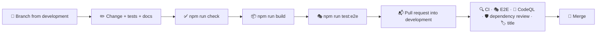

# 🤝 Contributing

## 🔄 Workflow



1. 🌿 Create a branch from `development`, named after the change: `feat/hourly-wind`, `fix/search-focus`.
2. ✅ Make your changes, add tests and run `npm run check` (and `npm run build` when routes, server code or configuration changed). For changes a visitor can see, also run `npm run test:e2e`.
3. 📝 Describe a user-visible change in one line under **Unreleased** in `CHANGELOG.md`.
4. 📬 Open a pull request into `development` and fill in the checklist from the template.
5. 🔀 Merge once everything is green. `development` reaches `staging` and `main` through the release flow in [Releases](./releases.md).

> [!TIP]
> `make setup` turns on the Git hooks in `.githooks/` (or run `git config core.hooksPath .githooks`). Before every commit they check the formatting and lint the staged files and look for em and en dashes; the message hook rejects messages that do not follow [Conventional Commits](#-commit-messages).

Bugs and ideas go through the issue forms in `.github/ISSUE_TEMPLATE`; security problems are reported privately as described in the [security policy](../.github/SECURITY.md).

> [!IMPORTANT]
> Keep `docs/` in sync with the code: a change to behaviour, a route, an environment variable or a script belongs in the same pull request as its documentation.

## 🧹 Code style

Formatting and linting are automated, so reviews can focus on behaviour.

- 🎨 **Oxfmt** formats TypeScript, SCSS, JSON, YAML and Markdown with a print width of 120 and sorts imports into groups. Run `npm run format`.
- 🧹 **Oxlint** enables the `correctness`, `suspicious` and `perf` categories with type-aware TypeScript rules, React hooks and React Compiler rules, the Next.js, `jsx-a11y`, `import`, `unicorn` and `vitest` plugins, plus the layer rules below. Run `npm run lint`.
- 🔷 **TypeScript** runs in strict mode with `noUncheckedIndexedAccess`, `verbatimModuleSyntax` and `erasableSyntaxOnly`.
- 🧾 **No em or en dashes** in code, docs or texts: `npm run lint:text`, part of `npm run check` and CI, points to each one. Use a comma, a colon or a hyphen instead.
- 🔗 **Shared files stay identical.** The Git hooks, the scripts in `scripts/` that all four apps use, the comment plugin and the editor and Dependabot settings are the same in tasks, weather, faceit-stats and finance; `make shared` compares them when the other apps are checked out next to this one, `make shared-sync` copies the files of the app you changed over the other three, and the weekly **Shared files** workflow checks out the other three repositories and runs the same comparison.

### 💬 Comments

Names, small functions and types carry the intent, and every function, component, hook and effect, and every block that is not obvious, gets one short line above it that says what it does:

```ts
// Drops later entries that describe an item already in the list
const unique = <Item>(items: readonly Item[], isSame: (a: Item, b: Item) => boolean) =>
```

> [!IMPORTANT]
> A custom Oxlint plugin in `lint/comments.js` (`local/short-comments`) reports comments longer than one line or 80 characters, comments at the end of a line of code and every lint, type or coverage directive (`eslint-disable`, `@ts-expect-error`, `istanbul ignore` and the like). Its second rule, `local/require-comments`, reports every function declaration and every variable holding a function without a comment line right above it.

Styles, configuration, Dockerfiles and workflows follow the same convention: mixins, keyframes, media and container queries and theme blocks carry a line too. Lists such as `.gitignore`, `.dockerignore` and the Oxlint overrides are split into groups, each with a one-line heading, and `tsconfig.json` groups its options the same way. Test helpers get a line like any other function. Anything that needs more than a line belongs in `docs/`.

### 🧭 Where code goes

| You are adding…                                        | Put it in                                           |
| ------------------------------------------------------ | --------------------------------------------------- |
| A localized page or one of its special files           | `src/app/[locale]/`                                 |
| An API endpoint or a file outside the languages        | `src/app/`                                          |
| Metadata, canonical links or structured data           | `src/features/seo/`                                 |
| A region of the page that combines several features    | `src/widgets/<Widget>/`                             |
| Data access, parsing or domain logic                   | `src/features/<feature>/model/`                     |
| A component that belongs to one feature                | `src/features/<feature>/ui/<Component>/`            |
| A helper or component that knows nothing about weather | `src/shared/lib`, `src/shared/ui`, `src/shared/api` |
| Design tokens and mixins                               | `src/shared/styles/`                                |

Imports only point downwards: `app → widgets → features → shared`. Oxlint reports any other direction.

> [!WARNING]
> Every link inside the app needs the language: build it with `homeHref()`, `placeHref()` or `cityHref()`. A bare `/` or `/?city=` costs a redirect and, in a `Link`, a wasted prefetch.

### 📐 Conventions

| Topic               | Convention                                                                                                                                       |
| ------------------- | ------------------------------------------------------------------------------------------------------------------------------------------------ |
| 🧩 Components       | One folder per component: `Name/Name.tsx` and `Name.module.scss`, arrow functions, default export                                                |
| 🖥️ Server or client | Server components by default; add `"use client"` only for state, effects, events or browser APIs                                                 |
| 🔒 Secrets          | Anything that needs the API key imports `server-only`                                                                                            |
| 🧮 Units            | Store metric values and convert only in `createFormatter()`                                                                                      |
| 🕰️ Time             | Unix seconds plus the city's offset; format with `toLocalDate()` and `timeZone: "UTC"`                                                           |
| 🌍 Texts            | Never hard-code UI text. Add a key to every file in `shared/i18n/messages/` and use `t()`                                                        |
| 🎨 Styles           | Tokens from `_tokens.scss`, the `glass`, `hover`, `pressable`, `section-label`, `visually-hidden` and `hide-in-print` mixins, logical properties |
| 🛡️ CSP              | No inline scripts and no `style` props; draw charts with SVG attributes                                                                          |
| 🏷️ State attributes | Use `data-*` or ARIA attributes (`data-sky`, `aria-pressed`, `aria-selected`) for visual states                                                  |
| 📥 Imports          | The `@/` alias for anything outside the current feature, relative paths inside it                                                                |
| 🧪 Tests            | Next to the code as `*.test.ts(x)`; query by role and accessible name; type every mock                                                           |

### 🃏 Adding a detail card

```tsx
import Card from "@/shared/ui/Card/Card";

import { progress } from "../../model/insights";
import Metric from "../Metric/Metric";
import type { ForecastViewProps } from "../props";

const GustsCard = ({ forecast: { current }, t, format, className }: ForecastViewProps) => {
  if (current.wind.gust === null) return null;
  return (
    <Card compact className={className} title={t("gusts.title")} icon="wind">
      <Metric value={format.speed(current.wind.gust)} share={progress(current.wind.gust, 0, 30)}>
        {t("gusts.note")}
      </Metric>
    </Card>
  );
};
```

A compact card is a tile: `Metric` gives it the value, one short word and a bar, and the tile shares its four rows with its neighbours. Add the messages in all ten languages, render the card in `widgets/Forecast/Forecast.tsx` and add a skeleton entry in `ForecastSkeleton`. Keep the number of tiles at six, so rows of six, three and two stay full; replace a tile rather than adding a seventh.

> [!TIP]
> Give a card that holds a row of values a container query instead of a page breakpoint, like `DailyForecast` and `WindCard`: cards are narrow on phones and in the side column alike.

## 📸 README pictures

`scripts/screenshots.mjs` takes every picture in `docs/images` from a running server with the saved places Lviv, Kyiv, Tokyo and London. Serve the production build against the mock API, then run the script:

```bash
make build
make mock                                     # in another terminal
OPENWEATHERMAP_API_KEY=e2e-key OPENWEATHERMAP_API_URL=http://127.0.0.1:4020 make start
make screenshots                              # node scripts/screenshots.mjs http://localhost:3000
```

The forecast follows the clock, so the pictures show the time they were taken. The current pictures show Friday 9 October 2026 at 11:31 UTC, when Lviv is in daylight; `SCREENSHOT_TIME` moves the browser to that moment, and `scripts/screenshot-clock.mjs` moves the mock and the server with it:

```bash
export SCREENSHOT_TIME=2026-10-09T11:31:00Z   # in every terminal
export NODE_OPTIONS="--import ./scripts/screenshot-clock.mjs"
rm -rf .next/cache/fetch-cache                # forecasts cached at another time would win
make mock                                     # in another terminal
OPENWEATHERMAP_API_KEY=e2e-key OPENWEATHERMAP_API_URL=http://127.0.0.1:4020 make start
make screenshots
```

> [!NOTE]
> The pictures use the still versions of the weather icons, so the drops and flakes of an animation never fall between two frames.

## 📝 Commit messages

Commits follow [Conventional Commits](https://www.conventionalcommits.org/):

```text
feat(search): suggest places in the interface language
fix(forecast): keep today's range when the daily forecast is missing
style: refine the storm sky
ci: verify npm registry signatures
docs: describe the free-key fallback
chore(deps): update next to 16.4
```

| Type          | Use it for                                      |
| ------------- | ----------------------------------------------- |
| ✨ `feat`     | A new feature                                   |
| 🐛 `fix`      | A bug fix                                       |
| ♻️ `refactor` | Code changes without new behaviour              |
| 💄 `style`    | Visual and styling changes                      |
| ✅ `test`     | Adding or updating tests                        |
| 📝 `docs`     | Documentation                                   |
| 👷 `ci`       | Pipeline and automation                         |
| ⚡ `perf`     | A faster or lighter app without new behaviour   |
| 📦 `build`    | The build, Docker images and build dependencies |
| 🔧 `chore`    | Dependencies and maintenance                    |
| ⏪ `revert`   | Reverting an earlier commit                     |

The `commit-msg` hook checks every message, and `.github/workflows/pr-title.yml` checks the title of every pull request, because a squash merge turns the title into the commit message.
