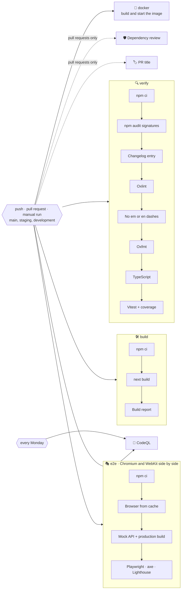

# 🚀 Deployment

Weather is a regular Next.js server: it needs Node.js, the `OPENWEATHERMAP_API_KEY` variable and, on a custom domain, `SITE_URL`. There is no database and no build-time secret.

## 🔁 Pipeline

`.github/workflows/ci.yml` runs on pushes to `main`, `staging` and `development`, on pull requests into them and on demand. Tags start the release workflow described in [Releases](./releases.md).



| Job                    | Runs on                       | What it does                                                                                                                                                                                                          |
| ---------------------- | ----------------------------- | --------------------------------------------------------------------------------------------------------------------------------------------------------------------------------------------------------------------- |
| 🔍 `verify`            | every trigger                 | `npm ci`, `npm audit signatures`, a changelog section for the current version, Oxlint with GitHub annotations, no em or en dashes, Oxfmt, TypeScript, Vitest with coverage, coverage summary and report               |
| 🛠️ `build`             | every trigger                 | The production build without an API key, then `scripts/build-report.mjs` checks the sitemap, robots, manifest, icons, flags, share images, proxy and headers and reports the bundle                                   |
| 🎭 `e2e`               | every trigger                 | Two parallel jobs, each with its browser from a cache keyed by the Playwright version, build against the mock OpenWeatherMap API: Chromium on desktop and phone with the Lighthouse budget, and WebKit, both with axe |
| 🐳 `docker`            | every trigger                 | Builds the staging image with Buildx and a layer cache in GitHub Actions from `docker/Dockerfile` without secrets, starts it and waits until `/healthz` answers                                                       |
| 🏷️ `pr-title`          | pull requests                 | Fails when the title does not follow Conventional Commits, so a squash merge keeps the history readable                                                                                                               |
| 🛡️ `dependency-review` | pull requests                 | Fails the pull request if it adds dependencies with high-severity vulnerabilities                                                                                                                                     |
| 🔬 `analyze` (CodeQL)  | pushes, pull requests, weekly | Scans TypeScript and the workflow files with the `security-extended` queries                                                                                                                                          |
| 🔗 `shared`            | Mondays and manual runs       | Checks out tasks, faceit-stats and finance and compares the files the four apps share                                                                                                                                 |
| 📸 `screenshots`       | manual runs                   | Takes the screenshots of the visual tests on Linux and uploads them for a commit, see [Testing](./testing.md#-visual-tests)                                                                                           |
| 📡 `monitor`           | hourly, Mondays               | Checks the live site and its Lighthouse scores once `MONITOR_URL` is set, see [Monitoring](#-monitoring)                                                                                                              |
| 🏷️ `release`           | `v*.*.*` tags                 | Checks that the tag matches `package.json` and sits on `main`, then publishes the GitHub release with the notes from `CHANGELOG.md` and the Docker image to GitHub Packages                                           |

- ⚡ `verify`, `build`, `e2e` and `docker` run in parallel, and `e2e` tests Chromium and WebKit side by side.
- 🗃️ The build and both end-to-end jobs keep `.next/cache/turbopack` between runs with `actions/cache`, keyed by the lockfile and the sources, so a build only recompiles what changed. The fetch cache is left out, so a build never reuses old API answers.
- 🛑 Pull request runs cancel superseded runs of the same branch.
- 🔐 The token is read-only and checkouts use `persist-credentials: false`.
- 🟢 Node.js is installed from `.nvmrc` and npm downloads are cached.
- 🔑 The build does not need the API key: every page that uses it is rendered on demand.
- 📤 The Playwright report, with a Lighthouse report for every budgeted page, is uploaded as an artifact even when the tests fail.

The build report is written to the workflow summary:

```text
### 📦 Build output

285 prerendered routes, 265 flags, 10 languages.

| File | Size | Gzip |
| --- | ---: | ---: |
| `static/chunks/….js` | 229.6 kB | 71.9 kB |
| **JavaScript, 14 files** | | **209.6 kB** |
| **CSS, 3 files** | | **12.7 kB** |

✅ The sitemap, robots rules, manifest, icons, flags, share images, the proxy and the security headers are in place.
```

## ⚙️ One-time GitHub setup

1. Open **Settings → Code security** and enable **Private vulnerability reporting**, **Dependabot alerts** and **Code scanning** (CodeQL uploads its results there).
2. Create `development` and `staging`, make `development` the default branch and protect `main` and `staging` as described in [Releases](./releases.md#️-one-time-github-setup).
3. After the first deployment, add the repository variable `MONITOR_URL` with the address of the live site, `https://weather.sacrificed.me`, under **Settings → Secrets and variables → Actions → Variables** to turn on the [monitor](#-monitoring).

> [!TIP]
> The `e2e` job never needs a real API key: the mock server answers every request, so forks and Dependabot pull requests run the full suite too.

## ☁️ Hosting

### ▲ Vercel

1. Import the repository in Vercel; the Next.js preset needs no changes.
2. Add the environment variables under **Settings → Environment Variables** for Production and Preview:

   | Variable                 | Value                           |
   | ------------------------ | ------------------------------- |
   | `OPENWEATHERMAP_API_KEY` | Your OpenWeatherMap key         |
   | `SITE_URL`               | Not needed on Vercel, see below |

3. Deploy. `main` is the production branch; `staging`, `development` and every pull request get preview deployments, see [Environments](./releases.md#️-environments).

4. Add `weather.sacrificed.me` under **Settings → Domains** and create the DNS record Vercel shows for it. Optionally let the `vercel.app` address redirect to the domain.

Without `SITE_URL` the address comes from `VERCEL_PROJECT_PRODUCTION_URL`, which Vercel sets to the custom domain once it is added, so canonical links, the sitemap and share cards follow it without a variable. `SITE_URL` is for Docker and other hosts, or to force another address.

> [!NOTE]
> `vercel.json` runs the server functions in `fra1` (Frankfurt), close to the visitors in Europe. Without it a new project runs them in `iad1` (Washington, D.C.), and every page that is not cached yet pays for a trip across the Atlantic. Pick another [region](https://vercel.com/docs/regions) there if most visitors live elsewhere.

> [!IMPORTANT]
> Vercel takes the Node.js version from `engines.node` in `package.json`. `>=24` lets it build with the newest major it supports, 24 today, and move to 26 on its own once Vercel offers it. A range that only allows a newer line than Vercel supports, such as `>=26`, fails the build with "invalid or discontinued Node.js Version".

> [!NOTE]
> Preview deployments are kept out of search engines automatically: robots disallow everything and pages are marked `noindex`.

> [!TIP]
> The search endpoint limits each visitor in the memory of a single instance, and Vercel runs several. For one limit across all of them, add a rule under **Firewall → Rules**: requests whose path is `/api/places`, rate limited to about 60 a minute per IP address, answered with `429`.

### 🐳 Docker

The shared service lives in `compose.yaml` at the root, and everything else in `docker/`: one multi-stage `Dockerfile` and an overlay per environment. `.dockerignore` keeps `node_modules`, build output, docs and every `.env*` file out of the build context.

| File                      | What it adds                                                                                |
| ------------------------- | ------------------------------------------------------------------------------------------- |
| `compose.yaml`            | The `app` service: build context, `docker/Dockerfile` and an init process                   |
| `docker/Dockerfile`       | Stages `base`, `deps`, `development`, `build` and `runtime`, a non-root standalone server   |
| `docker/development.yaml` | The dev server with hot reload through Compose Watch, variables from `.env`, port 3000      |
| `docker/staging.yaml`     | The production build with `APP_ENV=staging`, variables from `.env.staging`, port 3001       |
| `docker/production.yaml`  | The production build with `APP_ENV=production`, variables from `.env.production`, port 3000 |

```bash
docker compose -f compose.yaml -f docker/development.yaml up --watch
docker compose -f compose.yaml -f docker/staging.yaml up --build -d
docker compose -f compose.yaml -f docker/production.yaml up --build -d
```

The same with `make`, which also creates the env file of the environment (`.env`, `.env.staging` or `.env.production`) from `.env.example` on the first run and stops so you can fill it in:

```bash
make dev-up                  # [DEV] development with hot reload
make stage-up                # [STAGE] staging in the background
make stage-logs              # [STAGE] follow its logs
make prod-up                 # [PROD] production in the background
make prod-down               # [PROD] stop it, after typing yes
make status                  # which environments are running
```

- 🔐 **Secrets never enter the image.** The environment file is read at run time through `env_file` and mounted during the build as a BuildKit secret, so `SITE_URL` reaches the prerendered sitemap and robots rules without landing in a layer.
- 🧭 **`APP_ENV` decides indexing.** Every value except `production` turns on `noindex` and a `Disallow: /` robots file, the same as a Vercel preview.
- 📦 **The runtime stage is small.** `NEXT_OUTPUT=standalone` switches on the [standalone output](https://nextjs.org/docs/app/api-reference/config/next-config-js/output) only for Docker; the image keeps `server.js`, the traced dependencies, `public` and the static files, runs as the `node` user and reports its health through `/healthz`, a tiny route that answers `ok` without calling the weather service.
- 🏗️ **A build per platform.** The standalone server carries native modules such as `sharp`, so every architecture builds on its own platform: the release workflow builds amd64 on `ubuntu-latest` and arm64 on GitHub's `ubuntu-24.04-arm` runner, then joins them into one image. Emulating arm64 with QEMU is not an option, because the build crashes there while it draws the share images.
- 🔒 **Locked down.** Staging and production drop every Linux capability, forbid privilege escalation and get limits of 512 MB of memory, one CPU and 200 processes. The file system stays writable, because the server keeps regenerated pages in `.next`.
- 🔢 **Ports** default to 3000 and 3001, so staging and production fit on one host; `APP_PORT` overrides them. Staging and production restart on failure and rotate their logs.

> [!TIP]
> `docker compose -f compose.yaml -f docker/staging.yaml config` prints the merged configuration of an environment before anything is built.

#### 📦 Published images

Every release also publishes the production image to GitHub Packages, for amd64 and arm64, with build provenance and an SBOM:

```bash
docker run --rm --publish 3000:3000 --env OPENWEATHERMAP_API_KEY=your-key ghcr.io/sacrificed666/weather:1.0.0
```

The image is built with `APP_ENV=production` and the `SITE_URL` variable of the repository; the API key is only needed at run time.

### 🖥️ Any Node.js host

```bash
npm ci
SITE_URL=https://weather.example npm run build
OPENWEATHERMAP_API_KEY=… npm start          # listens on port 3000, or PORT
```

Put a reverse proxy with TLS in front of it and let it set `X-Forwarded-For`, which the search endpoint's rate limiter uses to tell visitors apart.

> [!WARNING]
> Set `SITE_URL` before `npm run build`: the sitemap and robots rules are prerendered and keep the address known at build time.

## 🗃️ Caching in production

| Layer              | What is cached                                 | How long                                                       |
| ------------------ | ---------------------------------------------- | -------------------------------------------------------------- |
| Next.js data cache | OpenWeatherMap responses, per URL and language | 10 min weather, 30 min air quality, 7 days geocoding           |
| Static output      | Flags, icons, manifest, app icons, share cards | Until the next build; browsers keep icons and flags for a week |
| Browser            | Saved and recent places                        | Until cleared                                                  |

Pages themselves are rendered per request, because they depend on the URL, the cookies and a fresh CSP nonce. On a host with several instances, each keeps its own data cache unless you configure a shared [cache handler](https://nextjs.org/docs/app/api-reference/config/next-config-js/cacheHandlers).

## 📡 Monitoring

`.github/workflows/monitor.yml` watches the live site once the repository variable `MONITOR_URL` holds its address. Until then both jobs are skipped.

| Job             | When                       | What it checks                                                                                                                                                                                                                                                                                                                                                                            |
| --------------- | -------------------------- | ----------------------------------------------------------------------------------------------------------------------------------------------------------------------------------------------------------------------------------------------------------------------------------------------------------------------------------------------------------------------------------------- |
| 📡 `uptime`     | every hour and manual runs | `scripts/check-live.mjs` loads `/healthz`, `/en`, `/.well-known/security.txt`, `/robots.txt`, `/sitemap.xml` and `/api/places?q=Kyiv`, which proves that the OpenWeatherMap key still works, each up to three times: every answer succeeds, a page has a title, `security.txt` stays valid for 30 more days, and a JSON answer has no error, no empty list and data at most two hours old |
| 🚦 `lighthouse` | Mondays and manual runs    | `scripts/lighthouse-live.mjs` runs Lighthouse on `/en` and `/uk` on a phone and a desktop: performance at least 80 and 90, everything else 100. The HTML reports are kept for 30 days                                                                                                                                                                                                     |

The paths and pages live under `monitor` in `package.json`, so the workflow and `make live` check the same list. Both scripts write a table to the summary of the run and also work locally, for example `node scripts/check-live.mjs https://weather.sacrificed.me /healthz`.

> [!TIP]
> GitHub emails the person who last changed the schedule when a scheduled run fails, so a failing check works as an alert. GitHub pauses the schedules of a repository without activity for 60 days; a push or a manual run turns them back on.

## 🤖 Dependency updates

`.github/dependabot.yml` checks for updates every Monday:

- 🌱 pull requests target `development`, so updates reach production with the next release;
- 📦 npm minor and patch updates are grouped into one pull request for production and one for development dependencies; major updates arrive separately;
- ⚙️ GitHub Actions updates are grouped into a single pull request;
- 🔒 `@types/node` stays on the major of the oldest Node.js in `engines`, so its major updates wait until `engines` moves;
- 🐳 the base images in `docker/Dockerfile` are updated one by one;
- 📝 commit messages follow the project convention (`chore(deps): …`, `ci(deps): …`, `build(deps): …`).

When `@meteocons/svg` or `@meteocons/svg-static` is updated, run `npm run icons` and commit the changed icons.

## 🖐️ Checking a build locally

```bash
npm run check
npm run build
npm start
```

Open `http://localhost:3000`, which redirects to your browser's language, and check a forecast in a couple of languages (`/en?city=Tokyo`, `/uk?city=Kyiv`), an unknown page, `/sitemap.xml`, `/robots.txt` and a share card such as `/en/opengraph-image/card`.

`npm run test:e2e` does the same automatically against the mock OpenWeatherMap API, including accessibility and the Lighthouse budget, without spending any of your API calls.
