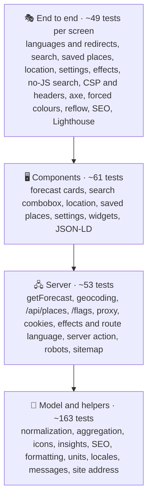
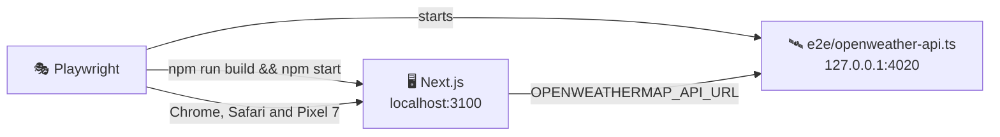

# 🧪 Testing

## 🧰 Stack

| Tool                            | Role                                                                  |
| ------------------------------- | --------------------------------------------------------------------- |
| ⚡ Vitest 5                     | Unit and component tests, configured in `vitest.config.ts`            |
| 🌐 jsdom 30                     | Browser-like environment for component tests                          |
| 🐙 Testing Library + user-event | Rendering components and driving them like a user                     |
| 🧩 jest-dom                     | Readable DOM assertions such as `toBeChecked()`                       |
| 📊 `@vitest/coverage-v8`        | Coverage reports and thresholds                                       |
| 🎭 Playwright                   | End-to-end tests in Chromium and WebKit, on desktop and phone screens |
| ♿ axe-core                     | Accessibility checks inside the end-to-end tests                      |
| 🚦 Lighthouse                   | Performance, accessibility, best practices and SEO budget             |

## ▶️ Running tests

| Command                 | Mode                                                                                         |
| ----------------------- | -------------------------------------------------------------------------------------------- |
| `npm test`              | 👁️ Unit tests in watch mode                                                                  |
| `npm run test:run`      | 🧪 Unit tests, single run                                                                    |
| `npm run test:coverage` | 📊 Unit tests with coverage and thresholds                                                   |
| `npm run test:e2e`      | 🎭 Production build against the mock OpenWeatherMap API, then Playwright, axe and Lighthouse |

The HTML coverage report is written to `coverage/index.html`, the Playwright report to `playwright-report/`; open the latter with `npx playwright show-report`.

> [!IMPORTANT]
> Install the browsers for the end-to-end tests once with `npx playwright install chromium webkit`, or `make browsers`.

## 🔺 Shape of the suite

Most behaviour is pinned down by fast tests of pure functions; component tests render with the real messages and assert on what a user sees. The end-to-end tests check what only a real browser and server can: redirects, status codes, the nonce-based Content Security Policy, streaming, layout on a phone and the accessibility of the finished pages.

## 📁 Where unit tests live

Tests sit next to the code they cover as `*.test.ts(x)`, and every component has its own file in its folder, for example `features/forecast/ui/WindCard/WindCard.test.tsx`:

| Area              | Files                                                                                                                                    | Covers                                                                                                                                                               |
| ----------------- | ---------------------------------------------------------------------------------------------------------------------------------------- | -------------------------------------------------------------------------------------------------------------------------------------------------------------------- |
| 🌦️ Forecast model | `normalize`, `getForecast`, `conditions`, `insights`                                                                                     | Parsing every endpoint, defaults and clamping, the free-key fallback and when it is remembered, every icon                                                           |
| 🖼️ Forecast UI    | `features/forecast/ui/*/*.test.tsx`, one file per card and state                                                                         | Every card in metric and imperial, polar days, missing data, the live clock, errors with references, skeleton                                                        |
| 📍 Places         | `place`, `location`, `geocoding`, `storedPlaces`, `features/places/ui/*/*.test.tsx`                                                      | URL parsing, links in every language, canonical queries, local names, the combobox, geolocation outcomes                                                             |
| ⚙️ Settings       | `preferences`, `server`, `actions`, `SettingsMenu.test.tsx`                                                                              | Cookies, the effects level for each device, the language of the route and of a request, the server action, the settings, language links, offline notice              |
| 📴 Notifications  | `offlinePage`, `OfflineNotice.test.tsx`, `ServiceWorker.test.tsx`                                                                        | The offline page with escaped texts and a policy that allows only its own style and script, the notice, the worker registered in production once the page has loaded |
| 🔎 SEO            | `features/seo/**/*.test.ts(x)`                                                                                                           | Titles, alternates, Open Graph and X fields, escaped JSON-LD, the place schema                                                                                       |
| 🌍 i18n           | `locales`, `translate`, `messages`, `useI18n`                                                                                            | `Accept-Language` matching, path helpers, placeholders, identical keys in all ten languages                                                                          |
| 🚀 App            | `api/places/route`, `flags/[code]/route`, `offline/[locale]/route`, `.well-known/security.txt/route`, `robots`, `sitemap`, `proxy`       | Same-origin check, limits, rate limiting, flags, robots rules, the sitemap, redirects and the nonce policy                                                           |
| 🧰 Shared         | `format`, `units`, `time`, `guards`, `rateLimit`, `storedList`, `contentSecurityPolicy`, `site`, `openWeather`, `shared/ui/*/*.test.tsx` | Intl formatting, conversions, storage failures, the public address, the API address, primitives                                                                      |
| 🧩 Widgets        | `widgets/*/*.test.tsx`                                                                                                                   | Header, footer with links that announce a new tab and the async Forecast widget with its structured data                                                             |

## 🧪 Fixtures and helpers

| Helper                                                                                     | File                   | Purpose                                                                     |
| ------------------------------------------------------------------------------------------ | ---------------------- | --------------------------------------------------------------------------- |
| `weatherResponse`, `forecastResponse`, `dailyResponse`, `airResponse`, `geocodingResponse` | `src/test/fixtures.ts` | Realistic OpenWeatherMap responses for Lviv at a fixed moment               |
| `forecast`, `view(overrides)`                                                              | `src/test/fixtures.ts` | A normalized forecast and the `{ forecast, t, format }` props of every card |
| `NOW`, `OFFSET`, `SUNRISE`, `SUNSET`                                                       | `src/test/fixtures.ts` | The fixed moment (3 October 2025, 17:00 in Lviv) and its time zone          |
| `jsonResponse(body, status)`                                                               | `src/test/fixtures.ts` | A `Response` for stubbed `fetch` calls                                      |
| `renderWithI18n(ui, locale)`                                                               | `src/test/render.tsx`  | Renders inside `I18nProvider` with English or Ukrainian and returns `user`  |

`src/test/setup.ts` adds the jest-dom matchers, replaces `next/link` with a plain anchor, and unmounts components and clears `localStorage` after every test. `vitest.config.ts` only collects `src/**/*.test.{ts,tsx}` and aliases `server-only` to an empty module, so server code can be tested directly.

Vitest runs with `pool: "vmThreads"`: one jsdom per worker, and every test file in a fresh context of its own, which is about twice as fast as a new process per file. Built-in browser objects such as `location` cannot be redefined in that pool: wrap a call such as `location.reload()` in a small module and spy on that module instead.

Unit tests run without React Compiler, the same in all four apps, so coverage counts the branches of the source rather than the cache checks the compiler adds. The production build, the end-to-end tests and Lighthouse cover the compiled code.

## 🧭 Testing Next.js code

- 🖧 **Server functions** (`getForecast`, geocoding) are tested by stubbing the global `fetch` with `vi.stubGlobal` and routing by `url.pathname`. `vi.stubEnv` sets or removes the API key; `vi.resetModules()` gives each test a fresh module state.
- 🍪 **Request APIs** (`cookies()`, `headers()`) are mocked with `vi.mock("next/headers")`.
- 🌍 **The route language** comes from `next/root-params`, mocked with `vi.mock("next/root-params")`.
- 🧭 **Navigation** is mocked with `vi.mock("next/navigation")`: `router.push()`, `usePathname()` and `useSearchParams()`.
- 🛣️ **Route handlers and the proxy** are called with a `NextRequest`, and their `Response` is inspected, including redirects and the request headers the proxy adds.
- ⏳ **Async server components** are awaited as functions and the returned element is rendered: `render(await Forecast({ query }))`.

> [!NOTE]
> `next/root-params` only works inside a Next.js build. Every test that reaches `getLocalization()` mocks it, or mocks `features/settings/model/server` as a whole.

## 🎭 End-to-end tests

`playwright.config.ts` starts two servers before the tests:

1. 🛰️ **The mock OpenWeatherMap API** (`e2e/openweather-api.ts`), a dependency-free Node server that answers the six endpoints the app uses. It knows four cities with different skies: Lviv (rain), Kyiv (clear), Reykjavik (snow) and Bangkok (thunderstorm), with local names in several languages and descriptions in English, Ukrainian, German and Czech. Times are relative to the moment of the request, so the clock, the hours and the days always make sense. Like a free key, it answers `401` for the daily forecast unless `E2E_DAILY_PLAN=1`.
2. 🖥️ **A production build** of the app with `OPENWEATHERMAP_API_URL` pointing at the mock and `SITE_URL` at the test server, served on port 3100.

> [!TIP]
> Locally both servers are reused when they are already running, so after the first run a repeated `npx playwright test e2e/accessibility.spec.ts` takes seconds. Start them yourself with the environment from `playwright.config.ts` to keep them between runs.

| Spec                       | Checks                                                                                                                                                                                                                                                                                           |
| -------------------------- | ------------------------------------------------------------------------------------------------------------------------------------------------------------------------------------------------------------------------------------------------------------------------------------------------ |
| 🌦️ `forecast.spec.ts`      | The default city, the week from the free forecast, keyboard search, an unknown city, saved places, geolocation, units and theme after a reload, the still sky by default and the moving one on Apple devices, the Effects setting after a reload, switching languages, search without JavaScript |
| 🧭 `routing.spec.ts`       | Redirect to the browser language (Ukrainian and Czech), the saved language winning, the city kept, lowercase languages, translated 404s with status 404, broken coordinates                                                                                                                      |
| ♿ `accessibility.spec.ts` | axe on six pages in five languages, the dark theme, the full effects of Apple devices in both themes, the settings and the suggestions, the skip link, forced colours mode, no sideways scrolling at 320 px and no word cut off at 360 px in Ukrainian, French and Portuguese, settings included |
| 🛡️ `security.spec.ts`      | No console errors or CSP violations while searching, saving settings and opening three languages, a fresh nonce per request, every header, the search API guards                                                                                                                                 |
| ✈️ `offline.spec.ts`       | The notice appears as a live region when the connection drops and goes away when it is back; a reload without a network shows the offline page in Ukrainian, which reloads itself once the connection is back                                                                                    |
| 🔎 `seo.spec.ts`           | Stable titles, canonical and `hreflang` links, `og:locale`, the canonical of the default city, JSON-LD, `noindex` for failures, the sitemap with the popular cities, robots, share images, manifest                                                                                              |
| 📸 `visual.spec.ts`        | Screenshots of the missing page in both appearances and on a phone, compared on Linux only                                                                                                                                                                                                       |
| 🚦 `lighthouse.spec.ts`    | The Lighthouse budget below                                                                                                                                                                                                                                                                      |

`e2e/helpers.ts` holds what several specs share:

| Helper                          | Purpose                                                                                                                                                                                                                                                   |
| ------------------------------- | --------------------------------------------------------------------------------------------------------------------------------------------------------------------------------------------------------------------------------------------------------- |
| `watchProblems(page)`           | Collects console errors and CSP violations and returns a check that expects none; Safari's `Load failed` is allowed as often as requests were cancelled, and its access control errors for the app's own addresses, which only a cancelled request causes |
| `openSettings(page)`            | Opens the settings panel                                                                                                                                                                                                                                  |
| `clippedText(page)`             | Texts that end in an ellipsis or are cut by their box, skipping hidden and transparent ones; the 360 px check expects none                                                                                                                                |
| `choosePreference(page, label)` | Picks a setting and waits for the server action, so a reload already sees the new cookie                                                                                                                                                                  |
| `endlessAnimations(page)`       | Counts the running animations that never end, the ones that keep the sky and icons moving                                                                                                                                                                 |
| `MAC_USER_AGENT`, `KYIV`        | A Mac `User-Agent` for the full effects and the address of Kyiv                                                                                                                                                                                           |

> [!NOTE]
> The test browsers report Linux, so **Auto** gives them the reduced effects. Specs that need the moving sky set `test.use({ userAgent: MAC_USER_AGENT })`.

CI runs the browsers as two parallel jobs, `npx playwright test --project=lighthouse` for Chromium on desktop and phone with the visual tests and Lighthouse, and `npx playwright test --project=webkit`; both commands work locally too.

Every spec except Lighthouse runs in **Desktop Chrome** and in **Desktop Safari** on WebKit, the engine of every browser on Apple devices, and every spec except SEO and Lighthouse also on a **Pixel 7** screen. In Safari, <kbd>Tab</kbd> skips links unless the setting is on, so the keyboard test presses <kbd>Option</kbd>+<kbd>Tab</kbd> there. The accessibility checks run with reduced motion, so transitions never catch axe halfway, and they also enable two axe rules that are off by default: `label-content-name-mismatch`, so a visible label always matches what voice control users say, and `target-size`, so every control is at least 24 × 24 px or far enough from its neighbours (WCAG 2.2, 2.5.8).

> [!NOTE]
> On Linux, as on the CI runners, the WebKit project browses with the user agent of Safari on Linux. WebKit there paints without a GPU, and the blurred glass and moving sky that Apple devices get would stall it until clicks time out, while Safari on Linux gets the lighter effects of every system but Apple's, as visitors with it do. The specs about Apple effects set a Mac user agent themselves, and a run on a Mac keeps the Mac agent everywhere. The one spec that switches the full effects on and reloads, **on a Windows computer**, is left to Chromium there.

> [!NOTE]
> Without JavaScript the streamed forecast stays in a hidden template, because React needs a small script to move it into place. The no-JS test therefore checks what has to work without scripts: the search form submits to `/{language}?city=…` and the new page has the right title.

### 📸 Visual tests

`e2e/visual.spec.ts` compares screenshots of the missing page in both appearances and on a phone with the files in `e2e/__screenshots__/`. The forecast follows the clock of the mock API, so the other specs cover it instead. Fonts and anti-aliasing differ from one system to another, so screenshots are only taken and compared on the Linux runners of GitHub Actions: the `visual` project exists when `CI` or `VISUAL` is set, and the Chromium job of `e2e` runs it before Lighthouse.

1. 📸 After a change in the design, start the **Screenshots** workflow (`.github/workflows/screenshots.yml`) from the **Actions** tab.
2. 📥 Download its `screenshots` artifact and unpack it into `e2e/__screenshots__/`.
3. 📝 Commit the new files together with the change.

> [!NOTE]
> Until `e2e/__screenshots__/` exists, the visual tests load the pages without comparing anything (`ignoreSnapshots`). A screenshot may differ in at most 1% of its pixels, and the HTML report of a failed run shows the expected, the actual and the difference side by side.

### 🚦 Lighthouse budget

`lighthouse.spec.ts` runs after the other projects, one page at a time, in a fresh Chromium:

| Page                    | Form factor | Performance | Accessibility | Best practices | SEO | Page weight |
| ----------------------- | ----------- | ----------: | ------------: | -------------: | --: | ----------: |
| 🌧️ `/en`                | 🖥️ Desktop  |      ≥ 0.90 |             1 |              1 |   1 |    ≤ 330 KB |
| 🌧️ `/en`                | 📱 Mobile   |      ≥ 0.80 |             1 |              1 |   1 |    ≤ 305 KB |
| ☀️ `/uk?city=Kyiv`      | 🖥️ Desktop  |      ≥ 0.90 |             1 |              1 |   1 |    ≤ 360 KB |
| ❄️ `/de?city=Reykjavik` | 📱 Mobile   |      ≥ 0.80 |             1 |              1 |   1 |    ≤ 315 KB |

The pages weigh 270 to 325 KB locally. Each page weight limit sits about 35 to 40 KB above what the page weighs today, the same rule in all four apps, so a heavier dependency or a bigger prefetch fails the build early; lower the limits again when a page gets lighter.

Every accessibility audit must pass as well, including the ones Lighthouse does not weigh into the score, and so must every weighted best practices audit (unweighted ones such as `valid-source-maps` cannot pass in a production build without source maps). Each run attaches the full Lighthouse HTML report to its test in the Playwright report, so a failed budget can be inspected in CI.

> [!NOTE]
> Lighthouse 13 sends a plain Chrome user agent, so Next.js would treat it as a browser and stream the metadata of a forecast into `<body>` once the weather arrives. The audit would then miss the description now and then. The spec appends `Chrome-Lighthouse` to the user agent, a token Next.js lists in `htmlLimitedBots`, so Lighthouse gets the metadata in `<head>`, like search engines that do not run JavaScript.

## 📐 Conventions

- 🎯 Query by role and accessible name (`getByRole("button", { name: "Save Lviv" })`). If something is hard to find this way, it is probably hard to use with a screen reader.
- 🖱️ Drive the UI with `userEvent`; use fake timers only for time-based behaviour, such as the clock or a message that hides itself.
- 👀 Assert on what the user sees, the URL pushed or the data stored, never on component state.
- 🔢 Keep logic that a component needs in a plain module (`insights.ts`, `normalize.ts`, `seo.ts`) so it can be tested without rendering.
- 🧪 Type every mock: `vi.fn<(href: string) => void>()`. Oxlint requires it.
- 🌐 Never call the real OpenWeatherMap API: stub `fetch` in unit tests and use the mock server in end-to-end tests.

> [!CAUTION]
> Oxfmt rewrites escape sequences inside `String.raw` templates. Write expected strings with escapes such as `<` as ordinary string literals with a doubled backslash (`'\\u003c'`), or the test silently compares against the unescaped text.

## 📊 Coverage

`npm run test:coverage` fails below these thresholds:

| Metric        | Threshold |
| ------------- | --------: |
| 📄 Statements |      98 % |
| 🔀 Branches   |      95 % |
| 🧩 Functions  |      98 % |
| 📏 Lines      |      98 % |

The suite currently covers about 99.4 % of statements, 96 % of branches, 99 % of functions and 99.7 % of lines. Each threshold sits about a point below the current coverage, the same rule in all four apps, so a change can only keep or raise it; raise them again when new tests add a point. Next.js special files that only compose other components (`layout`, `page`, `error`, `global-error`, `global-not-found`, `manifest` and the image routes) and the share card assets in `src/features/seo/og` are excluded, because the end-to-end tests and the production build cover them. CI publishes a coverage summary and uploads the HTML coverage and Playwright reports.
